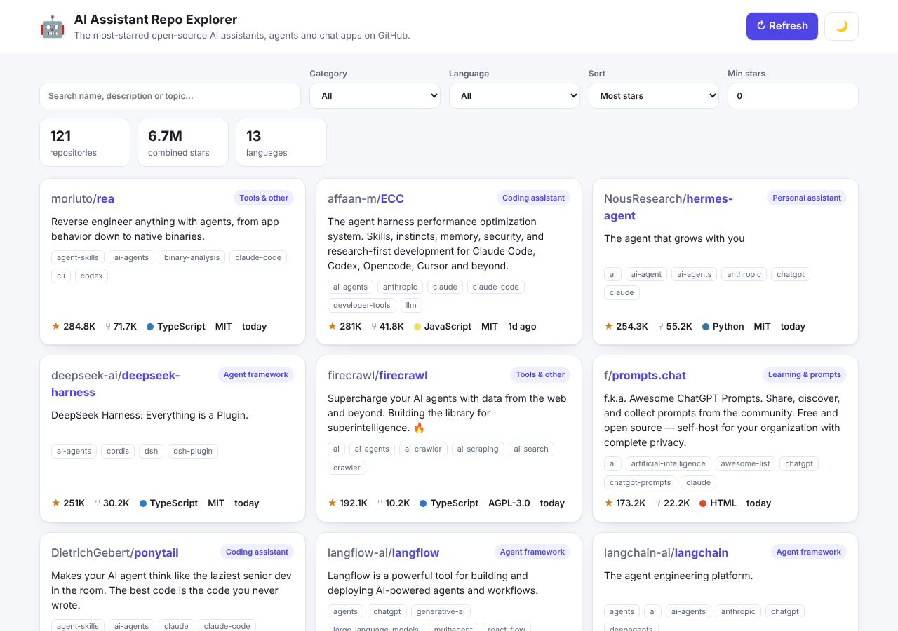

# AI Assistant Repo Explorer

A small web app for discovering and comparing the most popular open-source
**AI assistant** projects on GitHub: chat apps, agent frameworks, coding
assistants, personal assistants, knowledge/RAG tools and learning resources.

It runs a set of curated GitHub searches, merges and de-duplicates the results,
auto-categorises each repository, and lets you search, filter and sort them in
the browser. A bundled snapshot (`data/seed.json`) keeps the app working when
GitHub is unreachable or rate-limited.



## Quick start

Requires Node.js 20 or newer. There are **no npm dependencies** to install.

```bash
npm start
# → http://localhost:3000
```

Optional: put a GitHub token in `.env` (see `.env.example`) or export
`GITHUB_TOKEN` to raise the search limit from 10 to 30 requests per minute.

```bash
GITHUB_TOKEN=ghp_... npm start
```

## Features

- Live data from the GitHub Search API, cached in memory (default 10 minutes),
  with a **Refresh** button to force a re-fetch.
- Live results are layered on top of the bundled snapshot, so a rate limit or
  a failed query never shrinks the list; if every search fails the snapshot is
  shown on its own.
- A rejected `GITHUB_TOKEN` is detected once and the app continues
  unauthenticated instead of failing.
- Full-text search over name, description and topics.
- Filter by category and language, set a minimum star count, sort by stars,
  forks, last push or name.
- Filters are stored in the URL so views are shareable.
- Dark mode (follows the system, togglable).

## Categories

| Category | What goes here |
| --- | --- |
| Chat UI & desktop | ChatGPT-style web/desktop clients (NextChat, LobeHub, Cherry Studio) |
| Agent framework | Frameworks and harnesses for building agents (LangChain, Langflow, AgentScope) |
| Coding assistant | Code completion and coding agents (OpenHands, Tabby, OpenSpec) |
| Personal assistant | End-user assistants and bots (Leon, CowAgent, AstrBot) |
| Knowledge & RAG | Document Q&A, memory and knowledge platforms (mem0, DB-GPT, MaxKB) |
| Learning & prompts | Courses, cookbooks and prompt collections (prompts.chat, openai-cookbook) |

Categorisation is heuristic (topics + description keywords); see
`server/repos.js` to tune the rules.

## API

| Endpoint | Description |
| --- | --- |
| `GET /api/repos` | Repositories. Query params: `q`, `category`, `language`, `sort` (`stars`,`forks`,`updated`,`name`), `minStars`, `refresh=1` |
| `GET /api/health` | Cache state: data source, fetch time, repo count |

## Development

```bash
npm run dev           # restart on file changes
npm test              # unit + integration tests (node --test)
npm run refresh-seed  # re-fetch GitHub and rewrite data/seed.json
```

## Project layout

```
server/index.js        HTTP server + static files + JSON API
server/github.js       GitHub fetch, cache and seed fallback
server/repos.js        Pure helpers: normalise, categorise, filter, sort
server/refresh-seed.js Rewrites data/seed.json from live data
public/                Frontend (vanilla HTML/CSS/JS)
data/seed.json         Offline snapshot of the curated searches
test/                  node --test suites
```
